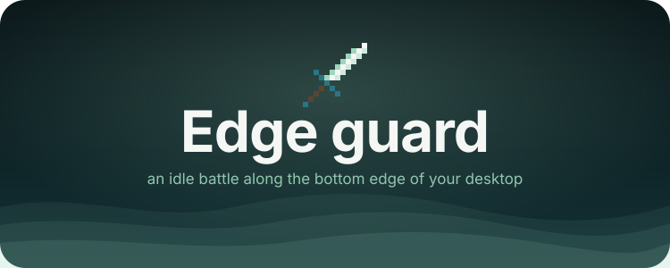
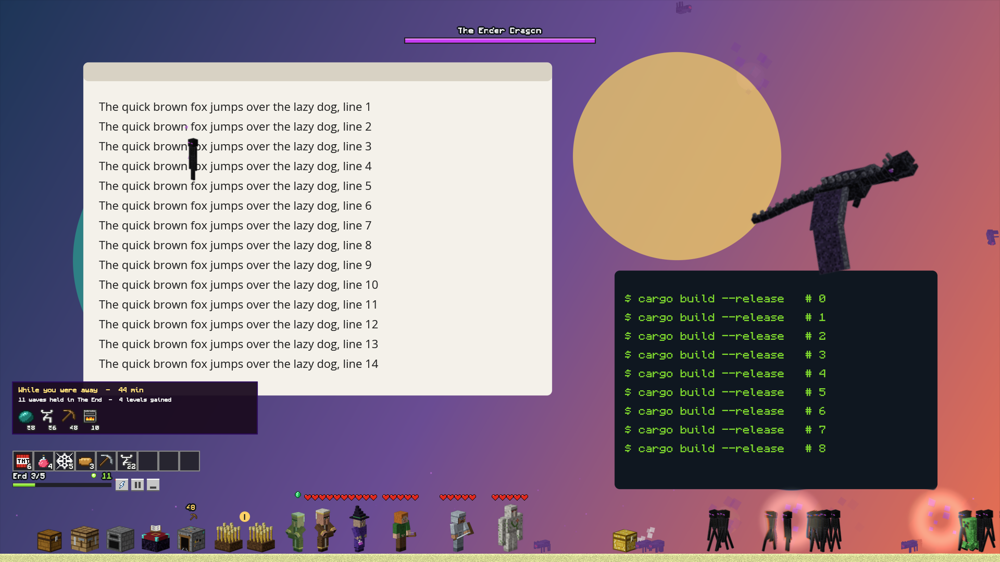
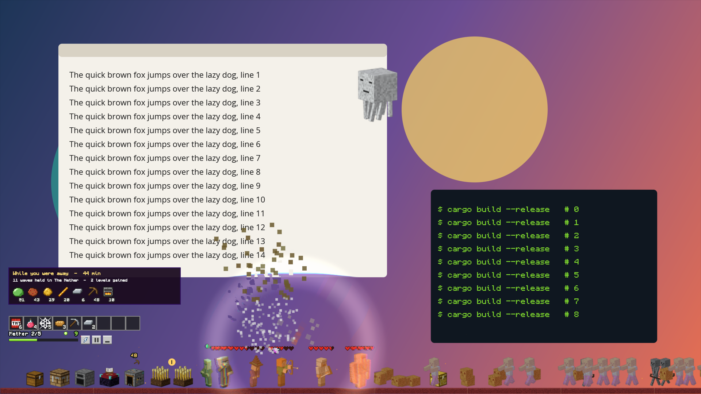

<div align = center>



<br>

[![Badge License]][License]
![Badge Language]
![Badge Commit]
[![Badge Issues]][Issues]
[![Badge Discord]][Discord]
[![Badge X]][X]
[![Badge Ko-fi]][Ko-fi]

<br>

Edge guard es una batalla pequeña que vive en el borde de abajo de tu monitor,
por encima de lo que tengas abierto, y se sale por toda la pantalla: un grupo
defiende su campamento de las oleadas que llegan a través de seis tierras, con
un señor al final de cada una. Está hecha con [pleamar], y los clics pasan a
tus ventanas en todas partes menos en las piezas del juego.

<br>

---

**[<kbd> <br> Instalar <br> </kbd>][Instalar]**
**[<kbd> <br> Jugar <br> </kbd>][Jugar]**
**[<kbd> <br> Derechos <br> </kbd>][Derechos]**
**[<kbd> <br> pleamar <br> </kbd>][pleamar]**
**[<kbd> <br> Discord <br> </kbd>][Discord]**

---

<br>

 

<sub>El dragón dando vueltas sobre un escritorio; una bola de fuego de un ghast estalla sobre el grupo y su onda dobla la ventana de detrás. *In English: [README.md](README.md).*</sub>

<br>
<br>

</div>

> [!IMPORTANT]
> **Juego no oficial hecho por fans.** NO ES UN PRODUCTO OFICIAL DE MINECRAFT.
> NO ESTÁ APROBADO POR MOJANG NI POR MICROSOFT NI ASOCIADO A ELLOS. No lleva
> ningún archivo de Mojang: cada dibujo lo hacen los scripts de `art/` y cada
> sonido es un tono generado al jugar. Las criaturas y los nombres que imita
> son suyos, así que es gratis para jugar y compartir, y **no se puede vender**.
> Más abajo, en [Derechos](#derechos).

# Qué necesita

- **Linux con un compositor Wayland que tenga layer-shell**: Hyprland, Sway,
  niri, river, KDE Plasma, [pleamar-wm](https://github.com/k4ditano/pleamar-wm)…
  No funciona en GNOME, que no tiene layer-shell, ni en X11.
- **[pleamar](https://github.com/k4ditano/pleamar) 0.4.10 o posterior**, el
  lenguaje en el que está escrito (el paso 1 de abajo).
- PipeWire o PulseAudio para el sonido, y un mando si quieres.

Las ondas que doblan tus ventanas leen lo que hay detrás del juego, así que
necesitan un compositor que deje capturar la pantalla (`wlr-screencopy`:
Hyprland, Sway, river…). Sin eso el juego funciona igual, solo que sin la onda.

Se ha jugado en pleamar-wm con una tarjeta NVIDIA y un monitor 1080p. En otros
compositores debería ir igual, pero no está probado: una
[issue](https://github.com/k4ditano/edge-guard/issues) contando qué viste ayuda.

# Instalar

**1. pleamar.** Su instalador lo compila en tu carpeta personal y deja
`pleamar` en `~/.local/bin`; no toca nada fuera de tu carpeta. `--alone`
instala solo pleamar, sin su gestor de ventanas ni su escritorio:

```sh
curl -fsSL https://raw.githubusercontent.com/k4ditano/pleamar/main/install.sh | sh -s -- --alone
```

Busca lo que necesita para compilar (Rust, un compilador de C…) y te ofrece
instalarlo con tu gestor de paquetes. En NixOS, o con Nix, usa el flake de
pleamar (`nix profile install github:k4ditano/pleamar`, o como input: mira el
[README de pleamar](https://github.com/k4ditano/pleamar#nix-and-nixos)).

**2. El juego.** Donde quieras; así queda junto al resto de tus datos:

```sh
git clone https://github.com/k4ditano/edge-guard ~/.local/share/edge-guard
~/.local/share/edge-guard/play.sh
```

Aparece en el borde de abajo de un monitor. Los clics pasan a tus ventanas en
todas partes menos en las piezas del juego.

**3. Con tu escritorio, y una tecla** (opcional). `play.sh stow` guarda el
juego en su esquina y lo vuelve a sacar; ponlo en una tecla. En la
configuración de tu compositor:

| Compositor | Que arranque con el escritorio | Una tecla para guardarlo y sacarlo |
|---|---|---|
| Hyprland | `exec-once = ~/.local/share/edge-guard/play.sh` | `bind = SUPER, G, exec, ~/.local/share/edge-guard/play.sh stow` |
| Sway | `exec ~/.local/share/edge-guard/play.sh` | `bindsym $mod+g exec ~/.local/share/edge-guard/play.sh stow` |
| niri | `spawn-at-startup "sh" "-c" "~/.local/share/edge-guard/play.sh"` | `Mod+G { spawn "sh" "-c" "~/.local/share/edge-guard/play.sh stow"; }` |
| KDE Plasma | Preferencias del sistema → Autoarranque → Añadir script de inicio de sesión → `play.sh` | Preferencias del sistema → Atajos → Añadir orden → `…/play.sh stow` |
| pleamar-wm | una línea `~/.local/share/edge-guard/play.sh` en `~/.config/pleamar/autostart` | `bind Super+g launch ~/.local/share/edge-guard/play.sh stow` en `~/.config/pleamar/keys.conf` |

**Actualizar:** `git -C ~/.local/share/edge-guard pull` (y `pleamar-update` para
pleamar). **Quitarlo:** `./play.sh stop` y borra la carpeta; la partida está en
`~/.local/share/pleamar/guard/` y la fuente en `~/.local/share/fonts/Monocraft.ttc`.

# Jugar

```sh
./play.sh            # en el monitor que elija tu compositor
./play.sh DP-1       # en ese monitor (sus nombres: `hyprctl monitors`, `wlr-randr`, `niri msg outputs`)
./play.sh stow       # lo guarda en su esquina, o lo vuelve a sacar
./play.sh stop       # lo cierra
```

La primera vez copia la fuente del juego (Monocraft) a `~/.local/share/fonts`.
Si no aparece nada, lánzalo desde una terminal: dice por qué (falta pleamar o
es antiguo, o el juego ya estaba abierto), y pleamar también.

**El campo**

- **Héroes:** arrastra uno a donde quieras que se ponga.
- **Los cofres** que quedan tras una oleada esperan a que los pulses.
- **La barra de nueve:** pulsa una cosa para usarla. TNT, poción y telaraña
  piden después dónde; el pan, un collar, un pico, un corazón de hierro o una
  campana se usan al momento.
- **El rayo** es el botón pequeño con un rayo: cae sobre quien esté más cerca
  del campamento y tarda veinte segundos en volver.
- **Otros dos botones pequeños:** pausa, y guardarlo en una esquina.
- **Mando:** el stick izquierdo mueve al caballero, A lanza el rayo, Y lo silencia.

**Las tierras y sus señores**

- Hay seis tierras de cinco oleadas, cada una con sus criaturas y con cosas que
  se encuentran allí más que en ningún otro sitio. Si cae el campamento, el
  grupo vuelve a la primera oleada de la tierra en la que está; un héroe caído
  sigue caído hasta que la oleada se gana o se pierde.
- La quinta oleada trae al **señor** de esa tierra. Avisa de lo que va a hacer:
  una marca en el suelo y una barra que se llena bajo su nombre. El TNT o el
  rayo lo paran y lo dejan aturdido; una telaraña sobre la marca atrapa a los
  que saltan o aparecen detrás del grupo; el fuego del señor del Nether se
  esquiva arrastrando a los héroes fuera de las marcas. Con media vida, llama
  a los suyos.
- Cada señor deja un **trofeo**. Con ellos se hace lo mejor: un gólem y un
  clérigo que se unen al grupo, un tótem, el último arco y los dos últimos
  bastones.
- Al caer un señor se abre el camino a la tierra siguiente. **El mapa** (una
  página de la mesa) lleva al grupo a cualquier tierra abierta, y puede
  decirle que se quede en una, para reunir lo que da.
- El señor del End deja un Ojo. Con él, el mapa abre **un mundo nuevo**: las
  tierras y los niveles del grupo empiezan de cero, todo es más fuerte, y el
  grupo conserva lo que lleva y gana una estrella para siempre.

**El campamento**

- **El cofre o la mesa de crafteo** abren la mesa: un panel de cristal sobre
  tu escritorio, con sus páginas en pestañas encima. Las cosas se llevan como
  allí:
  - un clic coge un montón y otro lo deja, sobre uno igual o cambiándolo por
    lo que haya; el botón derecho coge la mitad o deja uno;
  - **arrastrado por varias ranuras**, el montón se reparte a partes iguales
    (con el botón derecho, uno en cada una);
  - **doble clic** en una ranura junta en la mano todo lo de ese tipo;
  - **Shift** y clic manda el montón a su sitio: entre lo guardado y la
    barra, al horno o a la mesa de encantamientos, al héroe que puede
    ponérselo, fuera de la cuadrícula; sobre lo que sale de la cuadrícula,
    fabrica todo lo que se pueda;
  - **1 a 9** cambian la ranura bajo el ratón por esa ranura de la barra,
    **Sort** junta los montones iguales, y **Esc** o **E** cierran la mesa.

  **El libro**, a su izquierda, sabe las recetas de lo que ya has encontrado
  y las coloca al pulsarlas. Lo que tengas bajo el ratón dice qué es: para
  qué sirve, en qué entra y qué da el aldeano por ello.
- **El panel** de la derecha es el grupo: arma, casco, peto, botas y amuleto
  cada uno. La experiencia llena niveles, en verde; el `+` de un héroe los
  gasta en ese héroe.
- **La mesa de encantamientos** los gasta en lo que llevan: pon un arma o una
  pieza de armadura, lapislázuli al lado, y elige una de las ofertas.
- **El aldeano** tiene su puesto pasado el trigo. Compra lo que dejan las
  oleadas —tantos de una cosa por una esmeralda— y vende, por esmeraldas,
  pociones, TNT, lapislázuli, botellas de experiencia y más. Lo que quiere
  cambia con la tierra; cada oferta se puede usar unas cuantas veces, y vuelve
  a tenerlo todo al empezar la siguiente oleada. Los cofres también dejan
  esmeraldas de vez en cuando.
- **La mina** cava sola: púlsala para recoger lo que tenga. Un pico mejor
  encuentra más. **El horno** convierte hierro y oro en bruto en lingotes, con
  carbón o palos. **El trigo** crece solo: púlsalo cuando esté dorado.
- Los tres siguen con el juego guardado o cerrado (hasta ocho horas), y el
  grupo aguanta su tierra mientras tanto; al volver te cuenta lo que hicieron.
- `auto`, en la mesa, deja que el campamento lo haga todo solo: craftear,
  repartir, gastar los niveles en los héroes, alimentar el horno y recoger.
- Las otras páginas de la mesa son el **bestiario** (todo lo que has
  encontrado, cuántos han caído y qué dejaron) y los **logros**.

**Por toda la pantalla**

El campo está en el borde de abajo, pero lo que pasa en él no se queda ahí.
Una explosión manda una onda por tu escritorio que dobla tus ventanas a su
paso, y la pantalla tiembla; el rayo baja en zigzag desde arriba del monitor;
los endermans se teletransportan a cualquier punto de la pantalla y miran
desde encima de tus ventanas antes de volver; los slimes caen desde el borde
de arriba y las arañas bajan colgadas de su hilo. Antes de que llegue un
señor, su sombra, mucho más grande que él, cruza la pantalla por detrás de
todo, y sus pasos se notan. (La onda es pleamar leyendo lo que hay detrás del
juego: un shader de la escena puede, en un compositor que deja capturar la
pantalla.)

**Lo que vuela**

Algunos enemigos no andan. Los phantoms dan vueltas por la pantalla en las
últimas oleadas del mundo normal y se lanzan en picado contra el grupo; los
ghasts flotan altos sobre el Nether y escupen bolas de fuego — **pulsa una bola
para devolverla**, y acaba con el ghast que la lanzó. En la tercera oleada del
End llega el dragón, que da vueltas por todo tu escritorio y baja en picado a
ras del campo echando fuego; la oleada no se gana mientras viva. El arquero y
la bruja disparan a lo que vuela cuando no tienen nada a tiro en el suelo, el
rayo va a por el dragón, y cualquier cosa que vuele se puede pulsar para
golpearla.

La partida se guarda en `~/.local/share/pleamar/guard/guard5.json`.

# Derechos

**Edge guard es un juego no oficial hecho por fans. No es un producto oficial
de Minecraft, ni está aprobado, asociado ni respaldado por Mojang Studios ni
por Microsoft.** Está hecho por diversión, por alguien a quien le gusta el juego.

- **No hay ningún archivo de Mojang.** No se ha copiado ni extraído ninguna
  textura, modelo, sonido, música ni fuente de Minecraft: los dibujos los
  construyen los scripts de `art/` (cajas pintadas píxel a píxel y renderizadas
  con Blender) y los sonidos son tonos generados al jugar.
- **Los personajes, las criaturas y los nombres siguen siendo de Mojang.** El
  creeper, el enderman, el ghast, el dragón del End, el Nether, el End y lo
  demás pertenecen a Mojang Studios y Microsoft, y lo que se dibuja aquí los
  imita a propósito. Por eso es una obra de fan: **gratis para jugar y
  compartir, nunca para vender**, sin anuncios y sin nada que pagar. Ninguna
  licencia de este repositorio da derechos sobre ellos.
- «Minecraft» es una marca de Mojang Synergies AB. Aquí solo se usa para decir
  en qué se inspira; no es el nombre de este proyecto.
- **Si Mojang o Microsoft quieren que se cambie o se retire algo**, abre una
  [issue](https://github.com/k4ditano/edge-guard/issues) o escribe al
  responsable en GitHub, y se hará.
- **La fuente** es [Monocraft](https://github.com/IdreesInc/Monocraft), de
  Idrees Hassan, con la SIL Open Font License 1.1 (`fonts/OFL.txt`). No es la
  fuente de Mojang y va con su propia licencia.
- **El código** (`guard.plm`, `guard.luau`, `logic/`, `shaders/`, `art/`,
  `play.sh`) tiene licencia MIT ([LICENSE](LICENSE)): cógelo, cámbialo, haz tu
  propio juego con él. Esa licencia cubre lo escrito aquí, el código y los
  scripts de dibujo. No cubre, ni puede cubrir, los personajes y nombres de
  Mojang: un juego hecho a partir de este que los lleve es una obra de fan,
  como este. Lo mismo se dice en [NOTICE.md](NOTICE.md).

<!---------------------------------------------------------------------------->

[Instalar]: #instalar
[Jugar]: #jugar
[Derechos]: #derechos
[pleamar]: https://github.com/k4ditano/pleamar
[pleamar-wm]: https://github.com/k4ditano/pleamar-wm
[License]: LICENSE
[X]: https://x.com/k4ditano
[Discord]: https://discord.gg/N7kbYC49b2
[Ko-fi]: https://ko-fi.com/k4ditano
[Issues]: https://github.com/k4ditano/edge-guard/issues

[Badge License]: https://img.shields.io/badge/license-MIT%20(code)-9ed6bd?style=flat-square
[Badge Language]: https://img.shields.io/badge/made%20with-pleamar%20%2B%20Luau-2c7684?style=flat-square
[Badge Commit]: https://img.shields.io/github/last-commit/k4ditano/edge-guard?style=flat-square&color=9ed6bd
[Badge Issues]: https://img.shields.io/github/issues/k4ditano/edge-guard?style=flat-square&color=2c7684
[Badge Discord]: https://img.shields.io/badge/chat-Discord-5865f2?style=flat-square&logo=discord&logoColor=white
[Badge X]: https://img.shields.io/badge/follow-@k4ditano-000000?style=flat-square&logo=x
[Badge Ko-fi]: https://img.shields.io/badge/support-Ko--fi-ff5e5b?style=flat-square&logo=ko-fi&logoColor=white
