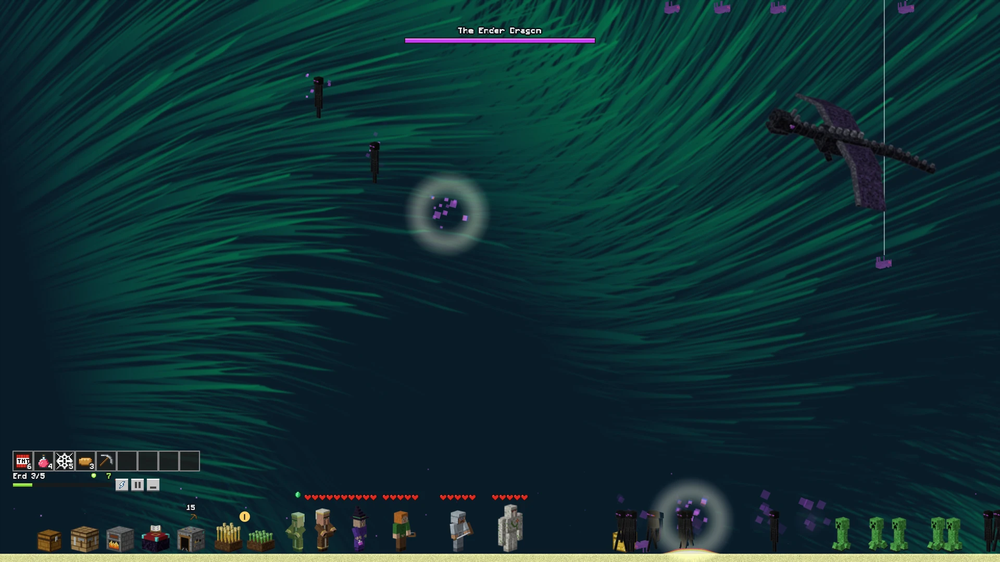
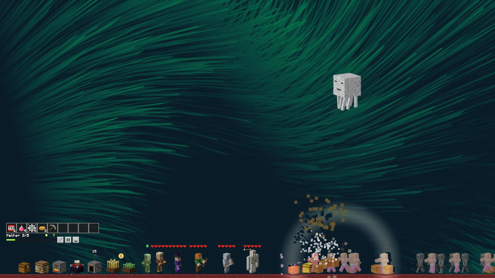
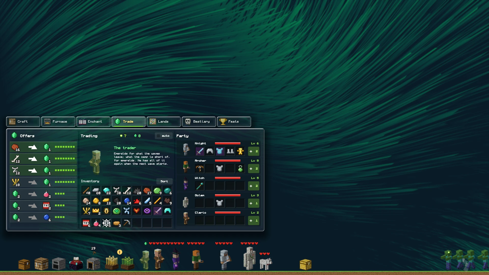

<div align = center>


<br>

[![Badge License]][License]
![Badge Language]
![Badge Commit]
[![Badge Issues]][Issues]
[![Badge Discord]][Discord]
[![Badge X]][X]
[![Badge Ko-fi]][Ko-fi]

<br>

Edge guard is a small idle battle that lives along the bottom edge of your
monitor, over whatever you have open, and spills over all of it: a party holds
its camp while waves come through six lands, each with a lord at the end. It is
written in [pleamar], and clicks go through to your windows everywhere except
on the game's own pieces.

<br>

---

**[<kbd> <br> Install <br> </kbd>][Install]**
**[<kbd> <br> Play <br> </kbd>][Play]**
**[<kbd> <br> Rights <br> </kbd>][Rights]**
**[<kbd> <br> pleamar <br> </kbd>][pleamar]**
**[<kbd> <br> Discord <br> </kbd>][Discord]**

---

<br>



<sub>The Ender Dragon loops over the desktop while the party holds its camp along the bottom edge. *En español: [LEEME.md](LEEME.md).*</sub>

<br>

 

<sub>A ghast's fireball goes off, and its ring bends the wallpaper; the camp's table, a pane of glass, open on the trader.</sub>

<br>
<br>

</div>

> [!IMPORTANT]
> **Unofficial fan game.** NOT AN OFFICIAL MINECRAFT PRODUCT. NOT APPROVED BY
> OR ASSOCIATED WITH MOJANG OR MICROSOFT. It contains no file of Mojang's: every
> picture is drawn by the scripts in `art/` and every sound is a tone made while
> it runs. The creatures and names it imitates are theirs, so it is free to play
> and to share, and **not to be sold**. See [Rights](#rights).

# What it needs

- **Linux with a Wayland compositor that has layer-shell**: Hyprland, Sway,
  niri, river, KDE Plasma, [pleamar-wm](https://github.com/k4ditano/pleamar-wm)…
  Not GNOME, which has no layer-shell; not X11.
- **[pleamar](https://github.com/k4ditano/pleamar) 0.4.10 or newer**, the
  language it is written in (step 1 below).
- PipeWire or PulseAudio for its sounds, and a game controller if you want one.

The rings that bend your windows read what is behind the game, so they need a
compositor that lets the screen be captured (`wlr-screencopy`: Hyprland, Sway,
river…). Without it the game plays the same, without the bending.

It has been played on pleamar-wm with an NVIDIA card and a 1080p monitor. On
any other compositor it should work the same, but it is untried: an
[issue](https://github.com/k4ditano/edge-guard/issues) with what you saw helps.

# Install

**1. pleamar.** Its installer builds it in your home and puts `pleamar` in
`~/.local/bin`; nothing outside your home is touched. `--alone` is pleamar by
itself, without its window manager and desktop:

```sh
curl -fsSL https://raw.githubusercontent.com/k4ditano/pleamar/main/install.sh | sh -s -- --alone
```

It finds what it needs to build (Rust, a C compiler…) and offers to install it
with your package manager. On NixOS, or with Nix, use pleamar's flake instead
(`nix profile install github:k4ditano/pleamar`, or as an input: see
[pleamar's README](https://github.com/k4ditano/pleamar#nix-and-nixos)).

**2. The game.** Anywhere you like; this puts it with the rest of your data:

```sh
git clone https://github.com/k4ditano/edge-guard ~/.local/share/edge-guard
~/.local/share/edge-guard/play.sh
```

It shows up along the bottom edge of a monitor. Clicks go through to your
windows everywhere except on the game's own pieces.

**3. With your desktop, and a key for it** (optional). `play.sh stow` puts the
game away into its corner and brings it back; bind it to a key. In your
compositor's configuration:

| Compositor | Start it with the desktop | A key to put it away and back |
|---|---|---|
| Hyprland | `exec-once = ~/.local/share/edge-guard/play.sh` | `bind = SUPER, G, exec, ~/.local/share/edge-guard/play.sh stow` |
| Sway | `exec ~/.local/share/edge-guard/play.sh` | `bindsym $mod+g exec ~/.local/share/edge-guard/play.sh stow` |
| niri | `spawn-at-startup "sh" "-c" "~/.local/share/edge-guard/play.sh"` | `Mod+G { spawn "sh" "-c" "~/.local/share/edge-guard/play.sh stow"; }` |
| KDE Plasma | System Settings → Autostart → Add Login Script → `play.sh` | System Settings → Shortcuts → Add Command → `…/play.sh stow` |
| pleamar-wm | a line `~/.local/share/edge-guard/play.sh` in `~/.config/pleamar/autostart` | `bind Super+g launch ~/.local/share/edge-guard/play.sh stow` in `~/.config/pleamar/keys.conf` |

**Update** with `git -C ~/.local/share/edge-guard pull` (and `pleamar-update`
for pleamar). **Remove** it with `./play.sh stop` and by deleting the folder;
your game is kept in `~/.local/share/pleamar/guard/`, and the font in
`~/.local/share/fonts/Monocraft.ttc`.

# Play

```sh
./play.sh            # on the monitor your compositor picks
./play.sh DP-1       # on that one (their names: `hyprctl monitors`, `wlr-randr`, `niri msg outputs`)
./play.sh stow       # puts it away into its corner, or brings it back
./play.sh stop       # closes it
```

The first time, `play.sh` copies the game's font (Monocraft) into
`~/.local/share/fonts`. If nothing shows up, run it from a terminal: it says
why (pleamar missing or too old, the game already running), and so does
pleamar.

**The field**

- **Heroes:** drag one to where it should stand.
- **Chests** left on the field after a wave wait until you press them.
- **The bar of nine:** press a thing to use it. TNT, a potion or a web then
  want a press where they should go; bread, a collar, a pickaxe, a heart of
  iron or a bell are used at once.
- **The lightning** is the small button with a bolt: it strikes whoever is
  nearest the camp, and is ready again in twenty seconds.
- **Two more small buttons** stop the game where it is, or put it away into a
  corner.
- **A game controller:** the left stick moves the knight, A calls the
  lightning, Y silences it.

**The lands and their lords**

- There are six lands of five waves. Each has its own creatures, and things
  that are found there more than anywhere else. When the camp falls, the party
  goes back to the first wave of the land it is in; a hero that falls stays
  down until the wave is won or lost.
- The fifth wave brings the land's **lord**. A lord announces what it is about
  to do: a mark on the ground and a bar that fills under its name. TNT or the
  lightning stop it and leave it dazed; a cobweb thrown on the mark catches
  the ones that leap or step behind the party; the fire of the Nether's is
  dodged by dragging the heroes off the marks. With half of it gone, it calls
  its own.
- A lord leaves a **trophy**. The best things are made with them: a golem and
  a cleric to join the party, a totem, the last bow and the last two staffs.
- When a lord falls the way to the next land opens. **The map** (a page of the
  table) takes the party to any land whose way is open, and can tell it to
  stay in one, to gather what that land gives.
- The lord of the End leaves an Eye. With it, the map opens **a new world**:
  the lands and the party's levels start over, everything is stronger, and the
  party keeps what it carries and is a star stronger for good.

**The camp**

- **The chest or the crafting table** open the table: a pane of glass over
  your desktop, its pages as tabs above it. Things are carried as there:
  - a press picks up a pile, another puts it down, onto a pile of its kind or
    in place of what is there; the right button takes half, or puts down one;
  - **dragged over several slots**, a pile is shared out evenly among them
    (with the right button, one in each);
  - **twice on a slot**, everything of that kind comes into the hand;
  - **Shift** and a press sends a pile where it belongs: between what is kept
    and the bar, into the furnace or onto the enchanting table, onto the hero
    who can wear it, out of the grid; on what the grid makes, as many as there
    is for;
  - **1 to 9** swap the slot under the mouse with that slot of the bar, **Sort**
    puts piles of a kind together, and **Esc** or **E** shuts the table.

  Lay things on the grid as the recipe says and take what they make from the
  slot at its right. **The book** at its left knows every recipe whose
  ingredients you have found, and lays one out when pressed. Whatever the mouse
  is on says what it is: what it does, what it goes into, what the trader
  gives for it.
- **The panel** at its right is the party: a weapon, a helmet, a chestplate,
  boots and a charm each. Experience fills levels, shown in green; the `+` on
  a hero spends them on that hero.
- **The enchanting table** spends them on what the heroes carry instead: put a
  weapon or a piece of armour on it, lapis beside it, and choose one of what
  it offers.
- **The trader** keeps a stall past the wheat. He buys what the waves leave
  —so many of a thing for an emerald— and sells, for emeralds, potions, TNT,
  lapis, bottles of experience and more. What he wants changes with the land;
  each offer can be taken so many times, and he has all of it again when the
  next wave starts. Chests leave emeralds now and then too.
- **The mine** digs by itself: press it to fetch what it has. A better pickaxe
  finds more. **The furnace** turns raw iron and raw gold into ingots, with
  coal or sticks. **The wheat** grows by itself: press it when it is golden.
- All three go on while the game is put away or closed (up to eight hours),
  and the party holds its land meanwhile; what they did is told when you come
  back.
- `auto`, on the table, lets the camp do all of that by itself: craft, hand
  things over, spend its levels on the heroes, feed the furnace, fetch and reap.
- The other pages of the table are the **bestiary** (everything you have met,
  how many have fallen and what they left) and the **feats**.

**Over the whole screen**

The field lies along the bottom edge, but what happens on it does not stay
there. A blast sends a ring through your desktop that bends your windows as it
passes, and the screen shakes; the lightning comes down crooked from the top
of the monitor; endermen step out to anywhere on the screen and look down from
over your windows before they come back; slimes drop from the top edge, and
spiders come down on threads of their own. Before a lord comes, its shadow,
far bigger than it, crosses the screen behind everything, and its steps are
felt. (The bending is pleamar reading what is behind the game: a scene's own
shader can, on a compositor that lets the screen be captured.)

**What flies**

Some foes do not walk at all. Phantoms wheel over the screen in the
overworld's later waves and dive at the party; ghasts float high over the
Nether and spit fireballs — **press a fireball to send it back**, and it
fells the ghast that threw it. At the End's third wave the Ender Dragon comes,
loops over your whole desktop and swoops down along the field breathing; the
wave is not won while it lives. The archer and the witch shoot at what flies
when nothing on the ground is within reach, the lightning goes for the dragon,
and anything up there can be pressed to strike it.

Your game is kept in `~/.local/share/pleamar/guard/guard5.json`.

# The pictures

Every picture in `pieces/` is made by the scripts in `art/`: the characters and
blocks are built box by box and rendered with Blender (`make.py`), packed into
sheets cut to share pleamar's atlas of pictures (`pack.py`), and the things
are written out pixel by pixel (`items.py`). `art/build.sh` makes them all again; it needs Blender and
Python's Pillow.

# Rights

**Edge guard is an unofficial fan game. It is not an official Minecraft
product, and it is not approved by, associated with or endorsed by Mojang
Studios or Microsoft.** It is made for fun, by someone who likes the game.

- **No file of Mojang's is in here.** No texture, model, sound, music or font
  of Minecraft's was copied or extracted: the pictures are built by the scripts
  in `art/` (boxes painted pixel by pixel and rendered with Blender), and the
  sounds are tones made while it runs.
- **The characters, creatures and names are Mojang's all the same.** The
  creeper, the enderman, the ghast, the Ender Dragon, the Nether, the End and
  the rest belong to Mojang Studios and Microsoft, and what is drawn here
  imitates them on purpose. That makes this a fan work: **free to play and to
  share, never to be sold**, with no ads and nothing to pay for in it. No
  licence in this repository gives anyone any right over them.
- "Minecraft" is a trademark of Mojang Synergies AB. It is used here only to
  say what this is inspired by; it is not this project's name.
- **If Mojang or Microsoft want anything here changed or taken down**, open an
  [issue](https://github.com/k4ditano/edge-guard/issues) or write to the
  maintainer on GitHub, and it will be done.
- **The font** is [Monocraft](https://github.com/IdreesInc/Monocraft) by Idrees
  Hassan, under the SIL Open Font License 1.1 (`fonts/OFL.txt`). It is not
  Mojang's font, and it is shipped under its own licence.
- **The code** (`guard.plm`, `guard.luau`, `logic/`, `shaders/`, `art/`,
  `play.sh`) is under the MIT licence ([LICENSE](LICENSE)): take it, change it,
  build your own game on it. That licence covers what was written here, the
  code and the drawing scripts. It does not, and cannot, cover Mojang's
  characters and names: a game made from this one with them in it is a fan
  work as this one is. The same is said in [NOTICE.md](NOTICE.md).

<!---------------------------------------------------------------------------->

[Install]: #install
[Play]: #play
[Rights]: #rights
[pleamar]: https://github.com/k4ditano/pleamar
[pleamar-wm]: https://github.com/k4ditano/pleamar-wm
[License]: LICENSE
[X]: https://x.com/k4ditano
[Discord]: https://discord.gg/N7kbYC49b2
[Ko-fi]: https://ko-fi.com/k4ditano
[Issues]: https://github.com/k4ditano/edge-guard/issues

[Badge License]: https://img.shields.io/badge/license-MIT%20(code)-9ed6bd?style=flat-square
[Badge Language]: https://img.shields.io/badge/made%20with-pleamar%20%2B%20Luau-2c7684?style=flat-square
[Badge Commit]: https://img.shields.io/github/last-commit/k4ditano/edge-guard?style=flat-square&color=9ed6bd
[Badge Issues]: https://img.shields.io/github/issues/k4ditano/edge-guard?style=flat-square&color=2c7684
[Badge Discord]: https://img.shields.io/badge/chat-Discord-5865f2?style=flat-square&logo=discord&logoColor=white
[Badge X]: https://img.shields.io/badge/follow-@k4ditano-000000?style=flat-square&logo=x
[Badge Ko-fi]: https://img.shields.io/badge/support-Ko--fi-ff5e5b?style=flat-square&logo=ko-fi&logoColor=white
